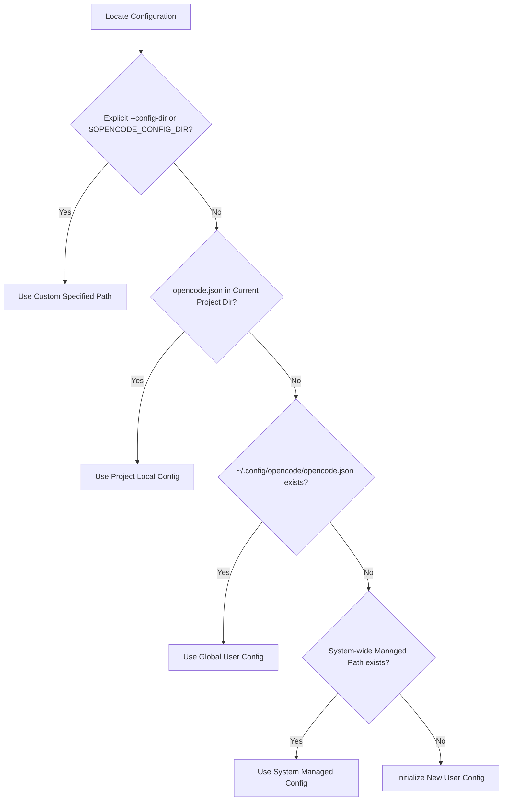

<p align="center">
  
</p>

<h1 align="center">OpenCode Companion</h1>

<p align="center">
  <strong>Local-First Web Dashboard & CLI Launcher for OpenCode Configuration</strong><br>
  Next.js 16 · TypeScript · Monaco Editor · Zero-Leak Privacy · JSONC Safe
</p>

<p align="center">
  <a href="https://www.npmjs.com/package/opencode-companion"></a>
  <a href="https://www.npmjs.com/package/opencode-companion"></a>
  <a href="LICENSE"></a>
  
</p>

<p align="center">
  
  
  
  
</p>

<p align="center">
  
  
  
</p>

<p align="center">
  <a href="https://github.com/yanndevgbut/opencode-companion"></a>
  
</p>

<p align="center">
  
</p>

<p align="center">
  English · <a href="#ringkasan-bahasa-indonesia">Ringkasan Bahasa Indonesia</a>
</p>

---

## Overview

**OpenCode Companion** (`opencode-companion`) is a local-first web dashboard and CLI launcher designed to configure and manage [OpenCode](https://opencode.ai) securely, visually, and instantly.

Engineered for developers, AI engineers, and power users: manage LLM provider catalogs, switch active default models, test Model Context Protocol (MCP) tool servers, safely edit `opencode.json` with comment preservation (JSONC), review side-by-side unified diffs, and use an integrated AI Assistant to propose verified patches via natural-language prompts.

Everything runs strictly on loopback (`127.0.0.1`), with zero external telemetry, no remote servers, and an airtight zero-secret-leak security model.

<table>
<tr>
<td width="65%" valign="top">

### Why OpenCode Companion

- **Instant Zero-Config Launch**: Run `npx opencode-companion@latest`, and your local browser immediately opens a ready-to-use configuration interface.
- **JSONC Comment Preservation**: Modify keys without stripping developer comments (`//` or `/* */`) from your existing `opencode.json` files.
- **Zero Secret Leaks**: Sensitive API keys and tokens are masked with HMAC-SHA256 placeholders (`{secret:hash}`) across the UI, Monaco editor, and diff view. Raw credentials are never leaked.
- **One-Click Automated Rollback**: Immutable point-in-time snapshots are automatically taken before any mutation is applied to disk.
- **Strict Schema Validation**: Backed by Zod validators and live Monaco schema checks to stop typos in provider, model, or context options before saving.
- **Safe MCP Subprocess Runner**: Testing local MCP commands requires explicit human button confirmation to prevent arbitrary background code execution.
- **AI Config Assistant**: Give plain-text instructions (e.g. *"Add Groq provider with Llama-3.3-70b model"*), and the assistant drafts a validated unified diff ready for your inspection.

</td>
<td width="35%" valign="middle">

<p align="center">
  
</p>
<p align="center">
  <small><em>Local-first · Privacy-first · Fast</em></small>
</p>

</td>
</tr>
</table>

---

## Table of Contents

- [Key Features](#key-features)
- [Security & Privacy Architecture](#security--privacy-architecture)
- [Quick Start](#quick-start)
- [CLI Flags & Options](#cli-flags--options)
- [Configuration Resolution Hierarchy](#configuration-resolution-hierarchy)
- [Dashboard Modules](#dashboard-modules)
- [REST API Reference](#rest-api-reference)
- [Monorepo Architecture](#monorepo-architecture)
- [Testing & Quality Verification](#testing--quality-verification)
- [FAQ & Troubleshooting](#faq--troubleshooting)
- [Contributing](#contributing)
- [License](#license)

---

## Key Features

| Module | Core Capabilities |
|---|---|
| **Overview & Diagnostics** | OpenCode binary detection, active configuration path resolution, read/write permission audit, port collision detection, and loopback connectivity check. |
| **Provider Manager** | Manage OpenAI, Anthropic, Gemini, Groq, Ollama, OpenRouter, DeepSeek, vLLM, and custom endpoints. Supports literal secrets, `{env:VAR}`, and `{file:path}` references. |
| **Model Catalog** | Default model switching, token context window limits, multimodal capabilities (vision, reasoning, tool calling), and reasoning effort controls. |
| **MCP Hub (Model Context Protocol)** | Add, edit, and toggle remote MCP servers (SSE/HTTP) or local commands (`npx`, `python`, binaries) with interactive live connection probes. |
| **Monaco Config Editor** | Integrated VS Code Monaco editor, real-time JSONC schema linting, auto-completion, and visual side-by-side diff review before committing. |
| **Backup & Rollback** | Automated pre-mutation snapshots, timestamped audit log, snapshot inspection, instant one-click rollback, and backup archive export. |
| **AI Config Assistant** | Natural-language assistant: supply a prompt, and the agent formulates structured JSON operations and a unified diff for explicit human approval. |

---

## Security & Privacy Architecture

OpenCode Companion enforces strict defense-in-depth controls for local developer tools:

| Security Vector | Implementation Details |
|---|---|
| **Strict Loopback Binding** | Binds exclusively to `127.0.0.1` by default. Requests from external networks (LAN/WLAN/WAN) are dropped at socket layer. |
| **Host Header Validation** | Validates the incoming `Host` header on every HTTP request. Requests with untrusted domains are rejected with `HTTP 403 Forbidden` (mitigates DNS rebinding). |
| **One-Time Session Token** | Launcher creates an ephemeral cryptographic token at startup. The web frontend authenticates via token query param, verified via middleware. |
| **Anti-CSRF & Origin Verification** | All state-mutating requests (`POST/PUT/DELETE`) require the `x-occ-csrf: 1` header and enforce matching loopback `Origin`. |
| **Zero Secret Leak (HMAC Masking)** | Sensitive API keys and tokens are transformed into deterministic HMAC-SHA256 masks (`{secret:hash}`). Plaintext keys never leave the server process. |
| **MCP Subprocess Confirmation** | Executing local MCP command-line tools requires explicit human confirmation via UI modal to prevent malicious background process spawns. |
| **Atomic File Transactions** | File writes target a temporary file first and atomically rename to the target path, eliminating corrupted configurations from crash events. |

---

## Quick Start

### 1. Launch with NPX (No Installation Required)

Fastest method without polluting your system packages:

```bash
npx opencode-companion@latest
```

Bypass session token authentication for fast local developer access:

```bash
npx opencode-companion@latest --no-auth
```

### 2. Global Installation

Install as a permanent CLI binary across your system:

```bash
npm install -g opencode-companion@latest
```

Once installed, run directly from any terminal:

```bash
opencode-companion
```

### 3. Run from Source (Local Clone)

For contributors and local workspace development:

```bash
git clone https://github.com/yanndevgbut/opencode-companion.git
cd opencode-companion
npm install
npm run build
npm start
```

### Terminal Startup Output

```text
==================================================
  OpenCode Companion v0.1.1
  Dashboard: http://127.0.0.1:3000/?token=ae9551847...
==================================================
* Running on 127.0.0.1 (Local device only)
* Preserving privacy: credentials remain local
* Press Ctrl+C to stop
```

---

## CLI Flags & Options

Customize port binding, configuration target directories, or authentication modes:

| Option / Flag | Type | Default | Description |
|---|---|---|---|
| `-p, --port <number>` | Number | `3000` | Preferred port (automatically falls back to next free port if occupied) |
| `--host <string>` | String | `127.0.0.1` | Network interface to bind |
| `--open` | Boolean | `false` | Automatically open dashboard URL in default system browser |
| `--config-dir <path>` | Path | *(auto)* | Explicit OpenCode config directory to manage |
| `--project-dir <path>` | Path | `process.cwd()` | Project root containing a local `opencode.json` |
| `--token <string>` | String | *(random hex)* | Custom session authentication token |
| `--no-auth` | Boolean | `false` | Disable session token check for local loopback |
| `-h, --help` | - | - | Display help menu and flag descriptions |
| `-v, --version` | - | - | Display installed `opencode-companion` version |

Advanced usage examples:

```bash
# Choose custom port and automatically launch browser
opencode-companion --port 8080 --open

# Target specific configuration folder with auth disabled
opencode-companion --config-dir ~/.config/opencode --no-auth
```

---

## Configuration Resolution Hierarchy

OpenCode Companion detects active configuration files in accordance with official OpenCode precedence rules:



1. **Custom Flag / Env**: `--config-dir`, `$OPENCODE_CONFIG_DIR`, or `$OPENCODE_CONFIG`.
2. **Project Local**: `./opencode.json` or `./opencode.jsonc` in active working directory.
3. **Global User**: 
   - Linux / macOS / Android Termux: `~/.config/opencode/opencode.json`
   - Windows: `%USERPROFILE%\.config\opencode\opencode.json`
4. **System Managed**:
   - Linux: `/etc/opencode/opencode.json`
   - macOS: `/Library/Application Support/opencode/opencode.json`
   - Windows: `%ProgramData%\opencode\opencode.json`

---

## Dashboard Modules

### 1. Overview & Diagnostics
Inspect OpenCode CLI binary status in system `PATH`, verify active configuration paths, audit filesystem permissions, and inspect current provider / MCP counts.

### 2. Provider & Key Management
Visual editor to register and configure LLM providers. Supports:
- Literal API key input (automatically redacted into HMAC hash upon saving).
- Environment variable references: `{"apiKey": "{env:OPENAI_API_KEY}"}`.
- Secret file path references: `{"apiKey": "{file:/path/to/token}"}`.

### 3. Model Catalog & Context Limits
Switch primary default models. Configure token context bounds, maximum completion tokens, and capability flags (vision, reasoning effort, tool call invocation).

### 4. MCP Server Hub
Manage Model Context Protocol tool integrations:
- **Remote Providers**: Connect via HTTP/SSE endpoints.
- **Local Subprocesses**: Spawn CLI tools (e.g., `npx -y @modelcontextprotocol/server-filesystem`). Includes interactive ping handshake checks.

### 5. Monaco Editor & Side-by-Side Diff
Full code editing experience powered by VS Code Monaco:
- Interactive JSONC validation against OpenCode schema.
- Developer comments (`//` and `/* */`) strictly preserved.
- Split-diff visualizer highlights additions, deletions, and updates before committing.

### 6. Automated Backup & Rollback
Companion creates an immutable snapshot under `~/.opencode-companion/backups/` before applying any file write. Revert accidental misconfigurations with instant one-click rollback.

---

## REST API Reference

Companion exposes a comprehensive local REST API for frontend navigation and automation scripts:

| Endpoint | Method | Description |
|---|---|---|
| `/api/status` | `GET` | Runtime statistics, binary installation status, and active config path. |
| `/api/providers` | `GET, POST` | Retrieve active provider list or upsert new provider definitions. |
| `/api/providers/[id]/test` | `POST` | Test network reachability and latency for a provider endpoint. |
| `/api/models` | `GET, POST` | Read catalog and update default active model. |
| `/api/mcp` | `GET, POST, DELETE` | Query, register, or remove MCP server definitions. |
| `/api/mcp/[name]/test` | `POST` | Execute connection probe or handshake to a target MCP server. |
| `/api/editor` | `GET, POST` | Read raw JSONC content or commit validated new content. |
| `/api/backups` | `GET, POST` | List snapshot archive or trigger an on-demand manual snapshot. |
| `/api/backups/[id]/restore` | `POST` | Restore configuration file to a specific historical snapshot. |
| `/api/diagnostics` | `GET` | Run end-to-end audit for permissions, schemas, and loopback. |
| `/api/assistant` | `POST` | Generate unified diff patch proposals via LLM instructions. |
| `/api/assistant/apply` | `POST` | Atomically apply assistant unified diff patch to disk. |

### cURL Verification Examples

```bash
# Verify local application status
curl -s http://127.0.0.1:3000/api/status

# Execute system diagnostics audit
curl -s http://127.0.0.1:3000/api/diagnostics
```

Sample `/api/status` response:

```json
{
  "install": {
    "installed": true,
    "binPath": "/usr/local/bin/opencode",
    "version": "2.0.32"
  },
  "config": {
    "activePath": "/root/.config/opencode/opencode.json",
    "exists": true,
    "isWritable": true,
    "providerCount": 3,
    "mcpCount": 2
  }
}
```

---

## Monorepo Architecture

```text
opencode-companion/
├── assest/                   # Branding assets and logo files
│   └── logo.png
├── apps/
│   └── web/                  # Next.js 16 Web Dashboard (App Router, Tailwind CSS, Monaco)
├── packages/
│   ├── schemas/              # Zod validation schemas and OpenCode types
│   ├── opencode-adapter/     # OS resolution, JSONC parser, atomic transactional file writer
│   ├── core/                 # Diagnostics engine, backup manager, AI assistant planner
│   └── cli/                  # CLI launcher, port finder, browser open, bundled standalone web
├── scripts/
│   ├── build.mjs             # Multi-package standalone bundler pipeline
│   └── smoke.mjs             # End-to-end loopback, security, and API test suite
└── tests/                    # Unit tests (Vitest)
```

---

## Testing & Quality Verification

All releases are validated with automated suites:

```bash
# 1. Run unit test suite (Vitest)
npm test

# 2. Run TypeScript strict type verification
npm run typecheck

# 3. Code style linting
npm run lint

# 4. End-to-end smoke test (CLI startup, security filters, loopback, API routes)
npm run smoke
```

---

## FAQ & Troubleshooting

### Q: Why does Companion select a different port than 3000?
**A:** If port `3000` is currently bound by another service, Companion scans sequential ports (`3001`, `3002`, etc.) and binds the first free socket without throwing an error.

### Q: Are my API keys ever transmitted to external servers?
**A:** Never. Companion has no telemetry, no tracking analytics, and no external cloud servers. All network traffic is strictly confined to `127.0.0.1` on your local device.

### Q: What happens to comments in my `opencode.json`?
**A:** They are completely preserved. The companion adapter uses an industrial-grade JSONC parser that applies structural updates without stripping comments or whitespace.

### Q: How do I terminate the running service?
**A:** Press `Ctrl + C` in the terminal session running Companion.

---

## Ringkasan Bahasa Indonesia

**OpenCode Companion** adalah dashboard lokal dan launcher CLI resmi untuk mengelola konfigurasi [OpenCode](https://opencode.ai) secara aman dan instan di perangkat lokal:

- **Jalankan instan**: `npx opencode-companion@latest`.
- **Zero secret leak**: API key disamarkan otomatis dengan placeholder HMAC-SHA256.
- **Preservasi komentar JSONC**: Mengubah konfigurasi tanpa menghapus komentar `//`.
- **Editor visual Monaco**: Validasi skema interaktif dengan peninjauan visual diff.
- **Cadangan otomatis**: Snapshot dibuat otomatis sebelum file diubah, siap di-rollback.
- **Model Context Protocol (MCP)**: Konfigurasi server HTTP/SSE dan command lokal.
- **AI Config Assistant**: Instruksi natural-language dengan persetujuan manusia.

---

## Contributing

Contributions, bug reports, and feature proposals are welcome!
1. Fork this repository.
2. Create your feature branch (`git checkout -b feat/my-new-feature`).
3. Commit your changes (`git commit -m "feat: add feature details"`).
4. Push to your branch (`git push origin feat/my-new-feature`).
5. Open a Pull Request.

---

## License

Distributed under the open-source **MIT License**.  
© 2026 [OpenCode Companion Contributors](https://github.com/yanndevgbut/opencode-companion).
