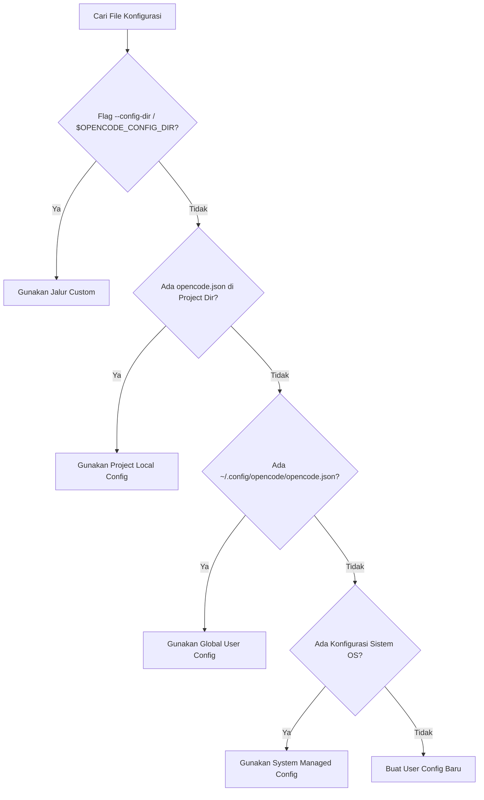

<p align="center">
  
</p>

<h1 align="center">OpenCode Companion</h1>

<p align="center">
  <strong>Local-First Web Dashboard & CLI Launcher untuk OpenCode Configuration</strong><br>
  Next.js 16 · TypeScript · Monaco Editor · Zero-Leak Privacy · JSONC Safe
</p>

<p align="center">
  <a href="https://www.npmjs.com/package/opencode-companion"></a>
  <a href="https://www.npmjs.com/package/opencode-companion"></a>
  <a href="LICENSE"></a>
  
</p>

<p align="center">
  
  
  
  
</p>

<p align="center">
  
  
  
</p>

<p align="center">
  <a href="https://github.com/yanndevgbut/opencode-companion"></a>
  
</p>

<p align="center">
  
</p>

<p align="center">
  Indonesia · <a href="#english-summary">English Summary</a>
</p>

---

## Ringkasan

**OpenCode Companion** (`opencode-companion`) adalah dashboard lokal berbasis web dan CLI launcher resmi untuk mengelola konfigurasi [OpenCode](https://opencode.ai) secara aman, visual, dan instan.

Dirancang untuk developer, AI engineer, dan power user: mengelola daftar LLM provider, memilih model default, menguji konektivitas server MCP (Model Context Protocol), mengedit `opencode.json` dengan preservasi komentar (JSONC), meninjau visual unified diff, serta memanfaatkan AI Assistant untuk memodifikasi pengaturan lewat instruksi natural language.

Semua proses berjalan murni di perangkat lokal (`127.0.0.1`), tanpa telemetri luar, tanpa cloud backend, dan menerapkan sistem proteksi kredensial nol kebocoran (*zero secret leak*).

<table>
<tr>
<td width="65%" valign="top">

### Kenapa OpenCode Companion

- **Satu Perintah Instan**: Cukup jalankan `npx opencode-companion@latest`, browser langsung membuka dashboard konfigurasi siap pakai.
- **Preservasi Komentar JSONC**: Mengubah konfigurasi tanpa merusak komentar struktur `//` atau `/* */` yang sudah ada di file `opencode.json`.
- **Zero Secret Leak**: Kredensial API key disamarkan otomatis dengan HMAC-SHA256 placeholder (`{secret:hash}`) di Monaco editor maupun tampilan diff. Kunci rahasia tidak pernah terekspos mentah.
- **Rollback Otomatis Satu Klik**: Snapshot cadangan (*point-in-time backup*) dibuat otomatis sebelum mutasi file dieksekusi ke disk.
- **Validasi Schema Ketat**: Zod validator dan Monaco schema interaktif mencegah salah ketik format provider, model, atau parameter konteks.
- **Safe MCP Runner**: Uji server MCP lokal via subprocess dengan dialog konfirmasi eksplisit untuk mencegah eksekusi kode tak terduga.
- **AI Config Assistant**: Berikan prompt sederhana ("*Tambahkan provider Groq dengan model Llama-3.3-70b*"), asisten membuat rencana patch unified diff tervalidasi yang siap ditinjau sebelum di-apply.

</td>
<td width="35%" valign="middle">

<p align="center">
  
</p>
<p align="center">
  <small><em>Local-first · Privacy-first · Fast</em></small>
</p>

</td>
</tr>
</table>

---

## Daftar Isi

- [Fitur Utama](#fitur-utama)
- [Model Keamanan & Privasi](#model-keamanan--privasi)
- [Quick Start](#quick-start)
- [Opsi CLI](#opsi-cli)
- [Hierarki Deteksi Konfigurasi](#hierarki-deteksi-konfigurasi)
- [Modul & Tampilan Dashboard](#modul--tampilan-dashboard)
- [Referensi REST API](#referensi-rest-api)
- [Struktur Monorepo](#struktur-monorepo)
- [Pengujian & Verifikasi Kualitas](#pengujian--verifikasi-kualitas)
- [FAQ & Troubleshooting](#faq--troubleshooting)
- [Kontribusi](#kontribusi)
- [Lisensi](#lisensi)

---

## Fitur Utama

| Modul | Kemampuan & Fungsi |
|---|---|
| **Overview & Diagnostics** | Status instalasi binary `opencode`, inspeksi path aktif, cek izin baca/tulis disk, deteksi bentrok port, dan uji loopback. |
| **Provider Manager** | Kelola OpenAI, Anthropic, Gemini, Groq, Ollama, OpenRouter, DeepSeek, vLLM, dan endpoint kustom. Mendukung literal key, `{env:VAR}`, atau `{file:path}`. |
| **Model Catalog** | Pemilihan model default, konfigurasi token context window limit, multimodal capabilities (vision, reasoning, tool calling), dan parameter reasoning effort. |
| **MCP Hub (Model Context Protocol)** | Tambah, edit, aktifkan/nonaktifkan server MCP remote (SSE/HTTP) maupun command lokal (`npx`, `python`, binary lokal) dengan tombol tes konektivitas interaktif. |
| **Monaco Config Editor** | Editor visual terintegrasi berbasis VS Code Monaco, syntax highlighting JSONC, linter skema OpenCode real-time, dan perbandingan side-by-side diff sebelum menyimpan. |
| **Backup & Rollback** | Riwayat snapshot otomatis per mutasi, metadata cap waktu, preview isi snapshot, tombol restore instan, dan ekspor arsip cadangan. |
| **AI Config Assistant** | Agen pembantu pengaturan: cukup ketik kebutuhan dalam teks biasa, LLM merancang operasi terstruktur dan unified diff untuk persetujuan pengguna. |

---

## Model Keamanan & Privasi

OpenCode Companion memprioritaskan keamanan absolut untuk aset kredensial pengguna:

| Aspek Keamanan | Mekanisme & Penjelasan |
|---|---|
| **Binding Loopback Ketat** | Server hanya mengikat antarmuka `127.0.0.1` secara default. Menolak permintaan dari jaringan luar (LAN/WLAN) kecuali pengguna sengaja memilih host lain. |
| **Host Header Protection** | Server memeriksa header `Host` pada setiap request masuk. Permintaan dengan header domain mencurigakan langsung ditolak dengan `HTTP 403 Forbidden` (mencegah DNS rebinding). |
| **One-Time Session Token** | Launcher menghasilkan token kriptografi acak saat startup. Browser memuat token via parameter URL dan memvalidasinya di middleware aplikasi. |
| **Anti-CSRF & Origin Enforcement** | Seluruh mutasi `POST/PUT/DELETE` wajib menyertakan header proteksi `x-occ-csrf: 1` dan mencocokkan header `Origin` dengan origin loopback server. |
| **Redaksi Rahasia (Zero Secret Leak)** | Nilai API key dan token otorisasi disaring menjadi token kriptografi HMAC-SHA256 (`{secret:hash}`). Kunci asli tidak pernah dikirim dalam payload respons frontend. |
| **Konfirmasi Subprocess MCP** | Menjalankan perintah server MCP lokal membutuhkan persetujuan tombol klik dari pengguna untuk mencegah eksekusi perintah berbahaya di latar belakang. |
| **Atomic File Operations** | Penulisan file konfigurasi dilakukan secara atomik melalui file temporer sebelum di-rename ke file target, meminimalkan risiko korupsi data saat sistem terhenti mendadak. |

---

## Quick Start

### 1. Jalankan Langsung via NPX (Tanpa Instalasi)

Cara tercepat, tidak perlu mengotori sistem:

```bash
npx opencode-companion@latest
```

Atau lewati autentikasi token untuk penggunaan lokal yang ringkas:

```bash
npx opencode-companion@latest --no-auth
```

### 2. Instalasi Global

Bila sering menggunakan Companion, pasang secara permanen:

```bash
npm install -g opencode-companion@latest
```

Setelah terpasang, jalankan perintah kapan saja:

```bash
opencode-companion
```

### 3. Jalankan dari Repositori Lokal

Jika menggunakan source code langsung dari direktori clone:

```bash
git clone https://github.com/yanndevgbut/opencode-companion.git
cd opencode-companion
npm install
npm run build
npm start
```

### Output Terminal Saat Berjalan

```text
==================================================
  OpenCode Companion v0.1.1
  Dashboard: http://127.0.0.1:3000/?token=ae9551847...
==================================================
* Running on 127.0.0.1 (Local device only)
* Preserving privacy: credentials remain local
* Press Ctrl+C to stop
```

---

## Opsi CLI

Gunakan flag CLI untuk menyesuaikan port, direktori target, atau mode otentikasi:

| Opsi / Flag | Tipe | Default | Keterangan |
|---|---|---|---|
| `-p, --port <number>` | Angka | `3000` | Port server yang diinginkan (otomatis mencari port berikutnya bila sibuk) |
| `--host <string>` | String | `127.0.0.1` | Antarmuka jaringan untuk binding |
| `--open` | Boolean | `false` | Otomatis membuka URL dashboard di browser bawaan |
| `--config-dir <path>` | Path | *(otomatis)* | Direktori eksplisit tempat `opencode.json` berada |
| `--project-dir <path>` | Path | `process.cwd()` | Direktori proyek yang memiliki `opencode.json` lokal |
| `--token <string>` | String | *(acak hex)* | Kustom token otentikasi sesi |
| `--no-auth` | Boolean | `false` | Nonaktifkan pengecekan token login di localhost |
| `-h, --help` | - | - | Tampilkan bantuan perintah dan daftar opsi |
| `-v, --version` | - | - | Tampilkan versi `opencode-companion` |

Contoh penggunaan tingkat lanjut:

```bash
# Memilih port spesifik dan membuka browser otomatis
opencode-companion --port 8080 --open

# Menargetkan folder konfigurasi custom
opencode-companion --config-dir ~/.config/opencode --no-auth
```

---

## Hierarki Deteksi Konfigurasi

OpenCode Companion memindai dan mengenali file konfigurasi mengikuti standar resmi OpenCode:



1. **Custom Flag / Env**: `--config-dir`, `$OPENCODE_CONFIG_DIR`, atau `$OPENCODE_CONFIG`.
2. **Project Local**: `./opencode.json` atau `./opencode.jsonc` di direktori proyek aktif.
3. **Global User**: 
   - Linux / macOS / Android Termux: `~/.config/opencode/opencode.json`
   - Windows: `%USERPROFILE%\.config\opencode\opencode.json`
4. **System Managed**:
   - Linux: `/etc/opencode/opencode.json`
   - macOS: `/Library/Application Support/opencode/opencode.json`
   - Windows: `%ProgramData%\opencode\opencode.json`

---

## Modul & Tampilan Dashboard

### 1. Dashboard & Status Diagnostik
Memantau kesehatan instalasi binary `opencode`, membaca versi CLI yang aktif di sistem PATH, memeriksa izin berkas konfigurasi, serta menampilkan ringkasan jumlah provider dan server MCP yang aktif.

### 2. Kelola Providers & API Keys
Antarmuka visual untuk menambahkan provider baru maupun mengubah kredensial. Kredensial mendukung:
- String literal API key (langsung di-redact saat disimpan).
- Referensi environment variable: `{"apiKey": "{env:OPENAI_API_KEY}"}`.
- Referensi file rahasia: `{"apiKey": "{file:/path/to/secret}"}`.

### 3. Model Catalog & Parameter
Memilih model utama yang aktif untuk tugas coding. Mengatur nilai konteks, max tokens, dan toggle kapabilitas seperti reasoning effort atau image parsing.

### 4. Manajemen MCP Tool
Daftar server Model Context Protocol yang terintegrasi dengan OpenCode:
- **Tipe Remote**: Menghubungkan endpoint HTTP/SSE eksternal.
- **Tipe Local Subprocess**: Menjalankan executable CLI (misal: `npx -y @modelcontextprotocol/server-filesystem`). Dilengkapi tombol ping untuk memverifikasi kesiapan komunikasi JSON-RPC.

### 5. Editor Visual Monaco & JSONC Diff
Menyediakan pengalaman edit manual bergaya VS Code langsung di peramban:
- Auto-complete dan schema validation interaktif.
- Mempertahankan komentar developer (`//` dan `/* */`).
- Tinjauan split-diff side-by-side: melihat baris yang ditambah, diubah, atau dihapus sebelum tombol commit ditekan.

### 6. Sistem Backup & Snapshot Rollback
Setiap kali ada perubahan yang disimpan, Companion membuat berkas snapshot cadangan di direktori `~/.opencode-companion/backups/`. Jika konfigurasi rusak akibat salah input, cukup klik **Restore** untuk mengembalikan keadaan file ke titik tersebut dalam hitungan milidetik.

---

## Referensi REST API

Companion mengekspos API internal untuk komunikasi frontend dan otomatisasi lokal:

| Endpoint | Method | Keterangan |
|---|---|---|
| `/api/status` | `GET` | Statistik status runtime, deteksi instalasi binary, dan path file aktif. |
| `/api/providers` | `GET, POST` | Mengambil daftar provider tervalidasi dan menambah/mengubah provider. |
| `/api/providers/[id]/test` | `POST` | Menguji konektivitas network ke API endpoint provider. |
| `/api/models` | `GET, POST` | Membaca model list dan memperbarui model default yang dipilih. |
| `/api/mcp` | `GET, POST, DELETE` | Mengambil, mendaftarkan, atau mencopot server MCP. |
| `/api/mcp/[name]/test` | `POST` | Menjalankan probe koneksi atau handshake ke server MCP tertentu. |
| `/api/editor` | `GET, POST` | Mengambil raw content file JSONC dan menyimpan teks baru dengan validasi. |
| `/api/backups` | `GET, POST` | Daftar arsip snapshot cadangan dan pemicu pembuatan snapshot manual. |
| `/api/backups/[id]/restore` | `POST` | Mengembalikan file konfigurasi aktif ke snapshot spesifik. |
| `/api/diagnostics` | `GET` | Menjalankan audit menyeluruh terkait izin akses dan format file. |
| `/api/assistant` | `POST` | Merumuskan rencana perubahan via LLM prompt. |
| `/api/assistant/apply` | `POST` | Mengaplikasikan rencana patch unified diff dari asisten ke file disk. |

### Contoh Verifikasi via cURL

```bash
# Cek status aplikasi lokal
curl -s http://127.0.0.1:3000/api/status

# Menjalankan diagnostik sistem
curl -s http://127.0.0.1:3000/api/diagnostics
```

Contoh respons `/api/status`:

```json
{
  "install": {
    "installed": true,
    "binPath": "/usr/local/bin/opencode",
    "version": "2.0.32"
  },
  "config": {
    "activePath": "/root/.config/opencode/opencode.json",
    "exists": true,
    "isWritable": true,
    "providerCount": 3,
    "mcpCount": 2
  }
}
```

---

## Struktur Monorepo

```text
opencode-companion/
├── assest/                   # Logo, banner, dan aset visual identitas
│   └── logo.png
├── apps/
│   └── web/                  # Next.js 16 Web Dashboard (App Router, Tailwind, Monaco)
├── packages/
│   ├── schemas/              # Zod validator skema konfigurasi OpenCode resmi
│   ├── opencode-adapter/     # Resolusi path OS, parsing JSONC, dan atomic file writer
│   ├── core/                 # Engine diagnostik, backup manager, dan planner asisten AI
│   └── cli/                  # CLI launcher, port finder, browser open, & packaged standalone
├── scripts/
│   ├── build.mjs             # Pipeline bundler standalone multi-package
│   └── smoke.mjs             # Suite pengujian integrasi & keamanan loopback
└── tests/                    # Unit testing (Vitest)
```

---

## Pengujian & Verifikasi Kualitas

Setiap rilis diuji dengan suite pengujian otomatis:

```bash
# 1. Jalankan unit test (Vitest)
npm test

# 2. Validasi tipe TypeScript
npm run typecheck

# 3. Linter kode
npm run lint

# 4. Smoke test integrasi (Keamanan, Auth Token, API, dan Loopback Binding)
npm run smoke
```

---

## FAQ & Troubleshooting

### Q: Mengapa port default saya berbeda saat Companion menyala?
**J:** Jika port `3000` sedang dipakai proses lain di sistem, Companion secara pintar memindai port berikutnya (`3001`, `3002`, dst.) dan mengikat port pertama yang kosong tanpa menyebabkan crash.

### Q: Apakah data API Key saya dikirim ke server OpenCode Companion?
**J:** Sama sekali tidak. Companion tidak memiliki server eksternal, telemetri analitik, maupun perantara cloud. Seluruh lalu lintas data berada 100% di loopback `127.0.0.1` perangkat Anda.

### Q: Apa yang terjadi jika file konfigurasi saya berisi komentar `//`?
**J:** File tetap aman. Adapter Companion menggunakan parser JSONC kelas industri yang memperbarui nilai data tanpa menghapus komentar dokumentasi Anda.

### Q: Bagaimana cara mematikan service?
**J:** Cukup tekan kombinasi tombol `Ctrl + C` pada jendela terminal yang menjalankan Companion.

---

## English Summary

**OpenCode Companion** is an open-source, local-first web interface and CLI launcher designed to configure and manage [OpenCode](https://opencode.ai) locally. Key features include:

- **Single command launch**: `npx opencode-companion@latest`.
- **Zero secrets leaked**: HMAC-SHA256 placeholder masking for credentials.
- **JSONC comment preservation**: Edit `opencode.json` safely without losing code comments.
- **Interactive Monaco editor**: Schema validation with side-by-side visual diff reviews.
- **Safety backups**: Automatic snapshots before each modification with instant rollback.
- **Model Context Protocol (MCP)**: Easily configure SSE and local command tool servers.
- **AI Config Assistant**: Prompt-driven configuration changes with human approval.

---

## Kontribusi

Kontribusi kode, ide fitur, dan pelaporan bug sangat diterima!
1. Fork repository ini.
2. Buat branch fitur baru (`git checkout -b feat/nama-fitur`).
3. Commit perubahan Anda (`git commit -m "feat: deskripsi perubahan"`).
4. Push branch ke GitHub (`git push origin feat/nama-fitur`).
5. Buat Pull Request baru.

---

## Lisensi

Didistribusikan di bawah lisensi open-source **MIT License**.  
© 2026 [OpenCode Companion Contributors](https://github.com/yanndevgbut/opencode-companion).
